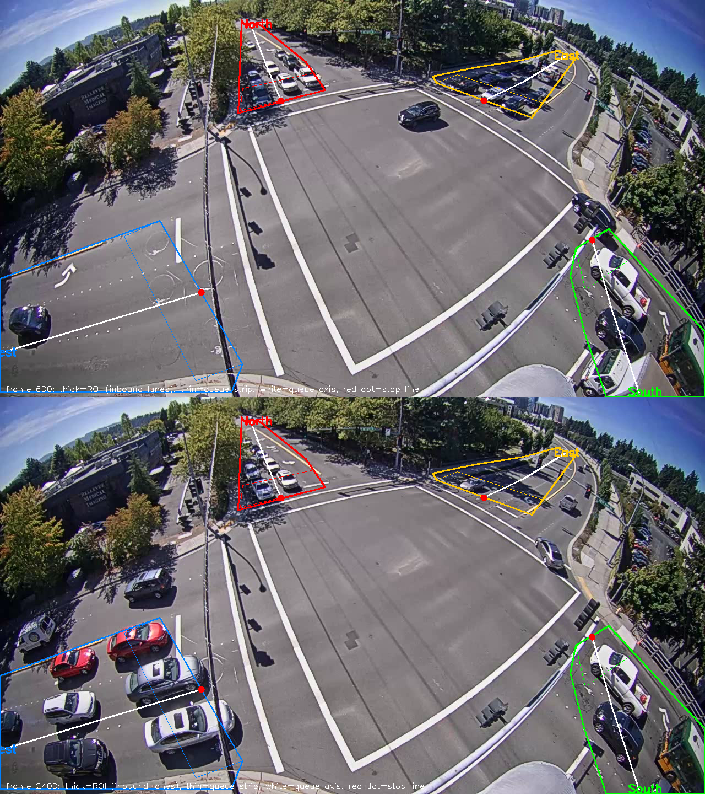
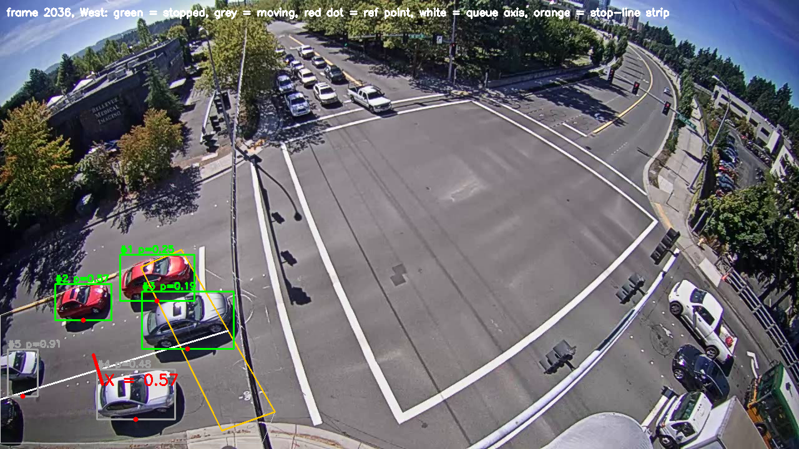
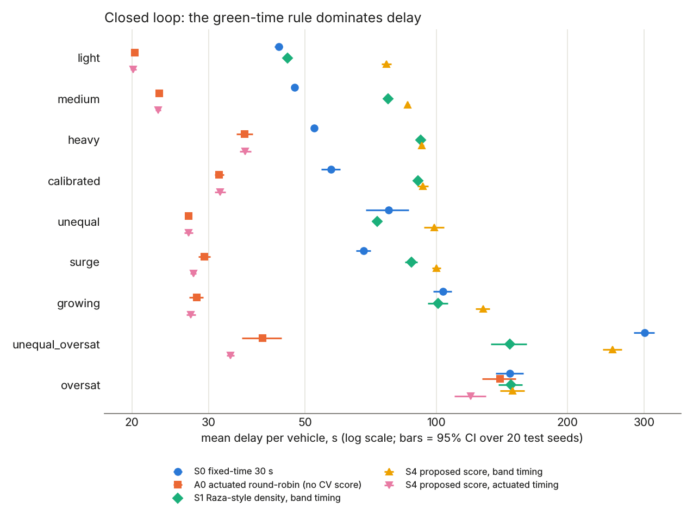
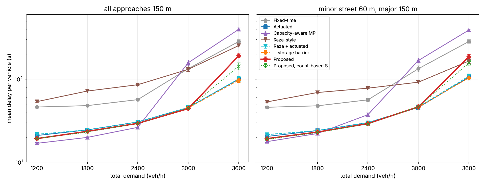
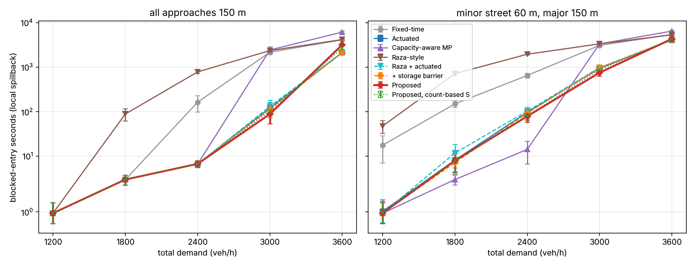

# How to use this guide

* **Part A** is the talk: the story in the order you tell it, with the sentence that links
  each stage to the next. Learn this first.
* **Part B** is the knowledge behind every stage: for each component, *what* it is, *why* it
  was done that way, *how* it works (with numbers), *where* it is in the code, and *where the
  idea came from*. When the professor asks "why?" or "how exactly?", the answer is here.
* **Part C** is the cross-question bank: the deep questions a strict examiner asks, with
  short answers.
* **Part D** is the reference: numbers to memorise, formula sources, code map, commands,
  glossary.

Read Part A until you can tell it without notes. Then read Part B one section per sitting,
and test yourself with Part C.

## The project in 60 seconds

> Traffic signals decide which road gets green and for how long. Raza et al. (2025) do this
> from a camera, but they only *count* vehicles. Newer research (Mohajerpoor et al., IEEE
> T-ITS 2023) shows that preventing queues from overflowing their road needs the queue's
> *position*, which they have to estimate with a model. I measure that position directly
> from video: YOLOv8 detects vehicles, ByteTrack follows them, and my method finds where the
> chain of stopped vehicles ends (X) and where it is heading (S). I first added X and S to
> the ranking score, and a pre-registered simulation showed it changes nothing, for a reason
> I can explain. I then used S as a storage limit in the green timing: near capacity it cuts
> spillback by 20–26% against standard actuated control at the same delay, and beyond
> capacity it fails. I report both.

\newpage

# Part A — The talk, stage by stage

Each stage: **Say** (what you tell the professor), **Show** (slide or figure), **Bridge**
(the sentence into the next stage). Total about 20 minutes.

## A1. The problem (2 min) — slides 1–5

**Say:** "A signalised junction repeatedly decides which approach gets green next and for
how long. Fixed-time plans repeat the same timings whatever the traffic. Adaptive control
measures the traffic. A loop detector sees one spot of road; a camera sees the whole road,
so it can measure *where a queue ends*. That matters because a queue that reaches the start
of its road — spillback — blocks traffic upstream."

**Show:** the demo frame (slide 3): boxes, IDs, approaches, queue tails.

**Bridge:** "So my question is: what should the camera measure, and does it improve control?"

## A2. The base paper and its limitation (2 min) — slides 6, 10

**Say:** "Raza et al. 2025 use YOLO to count vehicles, weight each by its PCE — a truck
counts as three cars — and sum them into a density D. The densest road gets green, for 40,
60 or 120 seconds depending on how dense. My analysis of their method: the state is a count.
It cannot tell where the queue ends or how long each road is. Ten cars on a 60-metre road
and ten on a 150-metre road look identical, though the first road is nearly full."

**Bridge:** "Newer research says exactly this position information matters."

## A3. Newer research and the gap (2 min) — slides 7–11

**Say:** "Li et al. 2025 estimate the queue *profile* in space, but need GPS trajectories
from connected vehicles and an offline solver. Wei et al. 2025 *predict* queues to act
before spillback, but assume the queue state is known. Mohajerpoor et al. 2023 control an
over-saturated junction with a spillback constraint — the queue must stay within β times
the link length — and a penalty that grows steeply as a queue nears the end of its link.
But they *estimate* where the queue is with a shockwave model. The gap: camera controllers
only count; spillback-aware controllers cannot see. My idea: measure the queue position
with the camera."

**Bridge:** "First I had to measure it reliably. Here is exactly how, on one real frame."

## A4. The measurement — the worked example (4 min) — slides 15–16

Follow one real frame (busy clip, frame 2036, West road; Part B7–B11 has every number):

1. "YOLOv8m gives a box per vehicle; ByteTrack gives each vehicle an ID that persists across
   frames. I take the bottom-centre of each box — where the wheels meet the road."
2. "I drew a line along each road from the stop line. A car's position p is how far along
   that line it is, as a fraction: car #2 is at p = 0.57."
3. "A car is *stopped* if it moved less than 0.2 of its own box height in the last second.
   Dividing by its own size cancels perspective; one second averages out box jitter;
   tracking tells me it is the same car."
4. "Walking back from the stop line through stopped cars, while each gap is under two car
   lengths, the last car is the queue end: X = 0.57."
5. "S projects X five seconds ahead from its trend: S = 0.55 here — steady."

"These fixes took false stops from 4.28 to 0.76 per vehicle."

**Bridge:** "Now I have, for every road and every frame, D, Q, X and S. How does the
controller use them?"

## A5. How the measurements drive the signal (2 min) — slide 15

**Say:** "Two decisions. *Which road next:* each road gets a score, the highest wins, and a
starvation guard makes sure no road is passed over more than three times. *How long:*
either Raza's bands — 30, 45 or 60 s by score — or actuated timing, which ends a green once
the stop-line zone has been empty for 2 seconds, never shorter than 10 or longer than 60."

**Bridge:** "To know whether any of this helps, I need a fair test — and the video cannot
give one."

## A6. Why video cannot evaluate control, and the audit (1.5 min)

**Say:** "Filmed cars obey the real light that was filmed, not my simulated one, so my
controller cannot change their waiting. An earlier result — 21% more throughput on video —
turned out to be an artefact: a control version with my new term set to zero gave exactly
the same number. So I use the video to test the *measurement*, and a simulator to test
*control*."

**Bridge:** "Here is the simulator setup."

## A7. The fair test (1.5 min) — slide 14

**Say:** "SUMO is an open-source traffic simulator in which vehicles stop and go because of
my signal. A virtual camera computes D, Q, X, S with the same definitions as the video
pipeline. Every method faces the same random traffic, so I compare paired differences with
95% confidence intervals. Every setting was fixed on separate validation runs and written
into a protocol before the final test ran."

**Bridge:** "My first enhancement put X and S into the ranking score."

## A8. Study 1 — the first enhancement and why it failed (1.5 min) — slide 17

**Say:** "This is an ablation: fixed-time; Raza-style; plus queue; plus count forecast;
plus my S; and a null control. Adding X or S changed delay by at most half a second and
changed the chosen road in one run out of forty. The reason: when a green ends, the road
with the longest queue is also the road with the most cars, so X ranks roads exactly as the
count does. What did matter was timing: actuated timing cut delay from 300 to 34 seconds in
the hardest scenario. Lesson: position information can only matter in the *timing*, and
relative to *each road's own length*."

**Bridge:** "That is exactly how Mohajerpoor uses it, so that is what I built next."

## A9. Study 2 — the final enhancement (2 min) — slides 18–19

**Say:** "One extra term in Raza's score and one timing rule. The term is
λ(1/(1.1 − S) − 1/1.1): near zero for a short queue, very large as the queue nears the end
of its road. The rule: after 20 seconds of green, end it early if a waiting road's S reaches
0.85. The *shape* of both is Mohajerpoor's; what is mine is measuring S with the camera
instead of a model, turning their optimisation into an online rule inside a camera
controller, and the experiments."

**Bridge:** "I tested it against standard and published baselines at five traffic levels."

## A10. Results — also the ablation (3 min) — slides 20–25

**Say:**

* "Two junctions — all roads 150 m, or a side street of 60 m — five demand levels, eight
  methods, twenty seeds. The rows are an ablation: Raza → plus actuated timing → plus
  barrier → plus protection → camera versus count."
* "Against Raza, 34 to 87 seconds less delay in nine of ten conditions — mostly from
  actuated timing."
* "Near capacity, 3000 vehicles per hour: 20 to 26 percent less spillback than standard
  actuated control, at the same delay. On the short road, the camera's measured queue beats
  a count by 115 seconds of spillback."
* "Beyond capacity, 3600: it fails — delay about doubles, because every road is near full
  and the rule keeps cutting greens. Mohajerpoor warns about exactly this regime."
* "Capacity-aware max pressure is the best method at light traffic; I report that too."

## A11. Close (1.5 min) — slides 24–27

**Say:** "Contributions: a calibration-free queue measurement from video; a storage-aware
rule built on it; and evidence of where it helps and where it fails. Limitations: X covers
only the visible road and misses far cars; one junction; no hand-labelled accuracy yet.
Next: switch protection off when every road is full; convert pixels to metres; better
detection on far roads; a two-junction corridor."

**Final line:** "The same camera measurement was useless for choosing the next road and
useful as a storage limit near capacity. *Where* information enters a controller matters
more than *what* is measured."

\newpage

# Part B — Everything behind the talk

## B1. Vocabulary of the problem

| Term | Meaning |
|---|---|
| Approach | One road entering the junction (here North, East, South, West) |
| Phase / green | The period one approach is allowed to move; here one approach at a time |
| Yellow | 3 s between greens; lost time for the junction |
| Delay | Time a vehicle loses compared with driving freely (SUMO "time loss") plus time it waited to enter a full road |
| Storage | The length of road an approach has for queueing |
| Spillback | The queue reaches the upstream end of its road, so arriving vehicles cannot enter |
| Capacity | The most traffic the junction can serve per hour |
| Under / near / beyond capacity | Demand well below, close to, or above capacity |
| PCE | Passenger Car Equivalent: car 1, motorcycle 0.5, bus and truck 3 |

## B2. Data

* **What:** three clips from the City of Bellevue Traffic Video Dataset (released for
  research), one fisheye camera at 116th Ave NE / NE 12th St: 107 s, 240 s and 240 s,
  re-encoded to a constant 30 frames per second, 1280 × 720.
* **Why this data:** a real, public intersection camera viewing all four approaches.
* **Limit:** one junction, daylight, one camera angle; the far legs (North, East) are small
  in the image.
* **Where:** `videos/`, `data/annotations/videos.json`.

## B3. Detection — YOLOv8m

* **What:** YOLO ("You Only Look Once") is a one-stage object detector: one pass of a
  convolutional network outputs boxes, classes and confidences. v8m = version 8, medium size.
* **Settings:** COCO-pretrained weights, classes car, motorcycle, bus, truck; confidence ≥ 0.3.
* **Training:** none. The COCO dataset already contains these classes. The contribution is
  what is computed *from* detections, not the detector.
* **Why m, not n:** recall on small, distant cars. On a test frame, YOLOv8n found 2 of ~9
  queued North cars and 0 of ~10 East; YOLOv8m found 4 and 3.
* **Where:** `src/tracking.py`; weights `models/yolov8m.pt`.
* **Source:** Ultralytics YOLOv8 (Jocher et al. 2023), the same family Raza uses.

## B4. Tracking — ByteTrack and the track cache

* **What:** ByteTrack links each frame's boxes to existing tracks by overlap and motion,
  giving each vehicle an ID that persists. Its key idea is to keep *low-confidence* boxes as
  candidates to continue an existing track, which keeps IDs through partial occlusion.
* **Why tracking is essential:** "stopped" means "this same vehicle barely moved over one
  second"; that needs to know which box was this vehicle a second ago.
* **Track cache:** detection and tracking run once per clip; the tracks are saved and every
  experiment replays them, so all controllers see identical detections and runs are fast
  and repeatable.
* **Where:** `src/tracking.py` (Ultralytics `persist=True`), `src/track_cache.py`,
  `results/track_cache/`.
* **Source:** Zhang et al., ByteTrack, ECCV 2022.

## B5. Geometry — regions and the queue axis

* **What:** per approach, drawn by hand once for this camera
  (`config/bellevue_116th_v2.json`):
  * ROI — polygon over the inbound lanes of that road;
  * queue strip (`queue_region`) — a small polygon just behind the stop line;
  * queue axis — a polyline from the stop line back along the road to the edge of the view.
* **Why redrawn (audit finding W7):** the original regions spanned two legs and both travel
  directions, the queue regions were not at the stop line, and two automatically
  estimated axes pointed the wrong way. So the old "queue reach" was not measured from a
  stop line at all. The v2 geometry fixed this.
* **Axis lengths:** North 149 px, East 168 px, South 290 px, West 381 px.
* **Where:** `src/lane_analysis.py`; picture `report/geometry_v2.png`.

{width=80%}

## B6. Assigning a vehicle to an approach

* **What:** a vehicle belongs to an approach if its **reference point** — the bottom-centre
  of its box, ((x1 + x2)/2, y2) — lies inside that approach's ROI (point-in-polygon test).
  It is "in the queue strip" if the point lies in the queue region.
* **Why the bottom-centre:** it is where the vehicle touches the road. The box centre of a
  tall truck floats above the road and can fall into the wrong region.
* **Where:** `src/lane_analysis.py` (`ApproachAssigner`).

## B7. Density D and queue Q

* **D** = (Σ over vehicles in the ROI of PCE) / `saturation_count`, capped at 1.
  `saturation_count` is how many vehicles the visible ROI holds (West 12, North 12, East 10,
  South 6).
* **Q** = (vehicles in the queue strip) / `queue_capacity` (4, or 2 on South), capped at 1.
* **Why normalise:** to put every measure on a 0–1 scale so they can be combined.
* **Source:** D is Raza's Eq. 1; the normalisation is this project's.
* **Example (frame 2036, West):** 5 cars → D = 5/12 = 0.417; 1 car in the strip → Q = 1/4 = 0.25.

## B8. The stopped test

$$\text{speed} = \frac{\text{distance the reference point moved over the last 1 s}}{1\,\text{s} \times h}, \qquad \text{stopped} \iff \text{speed} < 0.2$$

* *h* = the vehicle's box height in pixels: its own size in the image.
* **Why divide by h:** a far car is small, so moving one metre covers few pixels; a fixed
  pixel threshold calls far moving cars "stopped". Dividing by its own size puts near and far
  cars on the same scale — 0.2 box heights per second is about 1 m/s for a 5 m car.
* **Why one second:** boxes jitter by a few pixels every frame; the old test (moved < 2 px
  since the *previous frame*) flipped constantly. Over one second the jitter averages out.
* **Effect:** stops per vehicle 4.28 → 0.76 on the busy clip (audit W5).
* **Example:** car #3 moved 16.5 px in 1 s with h = 92 px → 0.179 → stopped.
  Car #4 moved 105.7 px, h = 80 → 1.32 → moving.
* **Where:** `src/traffic_metrics.py`, `_is_stopped_windowed`.

## B9. Position along the road, p

$$t = (\text{ref} - A)\cdot u, \qquad p = t / L$$

* *A* = first axis point (stop line); *u* = unit vector along the axis, upstream;
  *L* = axis length in pixels. For a multi-segment axis, the point is projected onto the
  nearest segment and the arc length is used.
* **Example (West):** A = (365, 530), u = (−0.957, 0.289), L = 381.2 px.
  Car #2 at (133, 513): t = 222.0 − 4.9 = 217.1 → p = 0.570.
* **Meaning:** p = 0.57 is 57% of the way from the stop line to the end of the *visible*
  road. No camera calibration is needed, but p is not in metres (perspective compresses far
  parts) and is relative to the visible stretch only.
* **Where:** `src/lane_analysis.py`, `_polyline_fraction`.

## B10. The queue tail X

* **Rule:** take the stopped vehicles, sort by p. Start at the first one inside the queue
  strip (or within its allowance of the stop line). Continue while
  p_next − p_previous ≤ allowance of the next vehicle. X = p of the last member; 0 if none.
* **Allowance** = 2 × (vehicle's length along the road) / L, with length along the road =
  |w·uₓ| + |h·u_y| (box width w, height h, road direction u).
* **Why contiguous:** a parked car or a detection far up the road is not part of the queue;
  without the chain rule one such car makes X jump. The old version jumped by more than 30%
  of the road in up to 8% of frames; now ≤ 1.1%.
* **Why length along the road, not box height:** cars on the West leg are seen side-on, twice
  as wide as tall; "two box heights" was shorter than one car plus its gap and broke real
  queues apart.
* **Example (frame 2036, West):** #3 p = 0.185 (in strip, starts) → #1 p = 0.250 (gap 0.065 ≤
  0.710) → #2 p = 0.570 (gap 0.320 ≤ 0.540) → **X = 0.570**.
* **Where:** `queue_tail_reach_scaled`, `_extent_along` in `src/traffic_metrics.py`.
* **Source:** this project's design; the idea of a spatial queue profile is from Li et al.

{width=85%}

## B11. The forecasts F and S, and the blind-spot proof

$$F = \mathrm{clamp}(Q + \text{slope}_Q \times 3\,\text{s}), \qquad S = \mathrm{clamp}(X + \text{slope}_X \times 5\,\text{s})$$

* **Slope:** least-squares straight line through the last 2.5 s (75 frames) of values; its
  slope in units per second. Many points make it robust to one noisy frame. (An earlier
  version used 0.5 s with a 5 s horizon, which multiplied noise by 10.)
* **clamp** keeps the result in [0, 1].
* **Meaning of S:** where the queue tail will be in 5 s. S = X for a steady queue, above X for
  a growing one, below for a clearing one. S = 1: the queue is projected to fill the visible
  road. It is *local* risk; the camera cannot see downstream.
* **Blind-spot proof (why X, not a count):** the strip holds 4 cars. Once full, Q = 1 every
  frame, its slope is 0, so F = 1 + 0 = 1 — "steady" — however fast cars keep joining behind
  the strip. F can only signal clearing. X keeps moving back, so S keeps rising.
* **Honest note (audit W3):** on the real footage Q = 1 in at most 0.6% of frames, so this
  blind spot is correct mathematically but rarely occurred in the clips; it is tested in
  simulation.
* **Example:** X steady at 0.570, slope −0.0035/s → S = 0.570 − 0.0175 = 0.552.
* **Where:** `QueuePredictor` in `src/traffic_metrics.py`.
* **Source:** the idea of acting on the predicted queue is Wei et al.; line extension by
  least squares is standard statistics.

## B12. The score (study 1)

$$\text{Score}_i = (1-\omega-\rho-\psi)\,[\alpha D_i + (1-\alpha) Q_i] + \omega F_i + \psi X_i + \rho S_i$$

* α = weight between D and Q (0.5); ω, ψ, ρ = weights of F, X, S. The proposed S4: ω = 0.3,
  ρ = 0.3, ψ = 0 → Score = 0.4(0.5D + 0.5Q) + 0.3F + 0.3S.
* **Why a weighted average:** every term is in [0, 1], so the score stays in [0, 1] and the
  green-time bands still apply.
* **The weights were set by hand and deliberately not tuned**, so the test could not be fitted
  to the data.
* **Example:** West = 0.4 × 0.333 + 0.3 × 0.630 + 0.3 × 0.552 = 0.488 (highest on that frame).
* **Where:** `compute_score_weighted` in `src/traffic_metrics.py`.

## B13. The controller and green timing

* **Which road next:** argmax of the score, with a **starvation guard**: an approach passed
  over 3 times in a row is served next. Raza has the same mechanism (a Green Denial Counter).
* **Raza-style bands:** score < 0.3 → 30 s; < 0.6 → 45 s; else 60 s (Raza: 40/60/120 s). A
  green never ends early.
* **Actuated timing:** green lasts at least 10 s; it ends once the stop-line strip has been
  empty for a 2-second passage time; at most 60 s. This is standard practice (FHWA Signal
  Timing Manual). The 2 s passage time came from testing: ending the green the moment the
  strip emptied cut greens mid-discharge.
* **Signal sequence:** GREEN → 3 s YELLOW → next approach.
* **Where:** `src/signal_controller.py` (`AdaptiveController`, `PhaseSequencer`).

## B14. The audit — what was wrong before, and how it was found

| Finding | What was wrong | How it was shown | Fix |
|---|---|---|---|
| W1 | Video "throughput" measures agreement with the *real* filmed light, not control quality | Served vehicles = recorded departures that happened to fall in simulated green; the "best" run kept North green all clip | Test control in closed-loop simulation only |
| W2 | The +21% (S3 → S4) was a weight artefact | Two things changed (S added and base weight 0.7 → 0.4); a NULL control with S = 0 gave exactly 158, same as S4 | Null control kept in every experiment |
| W3 | Q almost never saturated on the footage | Q = 1 in ≤ 0.6% of frames | Blind spot tested in simulation |
| W4 | One decision, one clip | S3 and S4 differed in one truncated phase | 20 seeds, 9 scenarios |
| W5 | X and S dominated by noise | 4.3 stops per vehicle; X jumps in 8% of frames | 1 s size-scaled stopped test; contiguous tail; 2.5 s slope |
| W6 | "Reproduction" of Raza overstated | Different bands, no lane-priority weights | Called "Raza-style" everywhere |
| W7 | Geometry did not define queues | Regions spanned two legs; axes pointed the wrong way | Redrawn v2 geometry |

**Where:** `AUDIT_REPORT.md`, scripts in `audit/`.

## B15. The simulation testbed (SUMO)

* **What:** SUMO (Simulation of Urban MObility), open-source, microscopic: every vehicle is
  simulated and obeys the signal. Driven from Python through `libsumo` every 0.5 s.
* **Junction:** four arms, two lanes each, straight-through, one approach green at a time,
  3 s yellow. Study 1: all approaches 150 m. Study 2: also a junction with 60 m East/West.
* **Demand:** random (Poisson) arrivals, 5% heavy vehicles. Study 1: 9 scenarios (light,
  medium, heavy, over-saturated, unequal, unequal over-saturated, surge, growing, and one
  calibrated from the video's measured shares). Study 2: 1200–3600 veh/h, split N 35%,
  S 30%, E 20%, W 15%. 1800 s of demand, first 300 s excluded as warm-up.
* **Virtual camera:** computes D, Q, X, S from simulated vehicle positions and speeds with
  the *same functions* as the video pipeline. Noise mode: up to 30% of far vehicles missed
  and 2 m position jitter.
* **Measures:** mean delay per vehicle (time loss + insertion delay); blocked-entry seconds
  (arrivals that cannot enter because the queue reaches the upstream end) = local spillback.
* **Why simulation:** it is closed loop — vehicles react to *my* signal — which recorded
  video cannot be.
* **Where:** `sim/scenario.py`, `sim/sensor.py`, `sim/closed_loop.py`, `sim/study2.py`.

## B16. Statistics — how a difference is judged real

* **Seed:** the number that fixes the random traffic. Every method runs on the same seeds,
  so they face identical traffic (common random numbers).
* **Paired difference:** method A minus method B on the same seed, averaged over 20 seeds.
  Pairing removes the large seed-to-seed variation.
* **95% confidence interval:** mean ± t × SD/√n (Student t, 19 degrees of freedom, t ≈ 2.09).
  If it excludes 0, the difference is called real.
* **Validation vs test seeds:** settings chosen on validation seeds (study 1: 0–3; study 2:
  0–9); results reported on test seeds (100–119; 200–219) run once.
* **Pre-registration:** the protocol was committed to git *before* the test seeds ran; the
  commit history proves the order (`sim/PROTOCOL.md`, `sim/PROTOCOL_STUDY2.md`).
* **Multiple comparisons:** with ~36 comparisons per table, one or two can look significant
  by chance at 95%; isolated marginal cells are not reported as effects.

## B17. Study 1 — design, result, reason

* **Arms (ablation):** S0 fixed 30 s; A0 actuated round-robin; S1 Raza-style (D only); S2 +Q;
  S3 +F; **S4 +S (proposed)**; NULL (S4 with S = 0); S4X (X instead of S); S3S, S3X (S or X
  instead of F).
* **Factors:** two timing rules (bands, actuated) × two density normalisers (physical:
  never saturates; saturating: 10 vehicles, like the video) × exact and vision-noise sensors.
* **Result:** adding X or S changed mean delay by at most ±0.5 s; no improving effect
  anywhere. The decision analysis found S changed the chosen approach in 1 of 40 runs.
* **Reason 1:** at decision time every red road has a growing queue, and the longest queue
  (largest X) is also the most vehicles (largest D): a term that agrees with the ranking
  cannot change an argmax.
* **Reason 2:** X saturates too: when a queue fills the visible road, X = 1 for every full
  road in over-saturation.
* **What did matter:** actuated timing halves delay against fixed-time; under unequal
  over-saturated demand 300.6 → 33.8 s. Raza-style bands are worse than fixed-time in most
  scenarios, because every green is at least 30 s and never ends early.

{width=80%}

## B18. Study 2 — the final enhancement

**Method:**

$$\text{score}_i = D_i + \lambda\left(\frac{1}{\alpha - S_i} - \frac{1}{\alpha}\right), \quad \lambda = 1,\ \alpha = 1.1$$

* *D* uses one common normaliser for every road: storage-blind, as in Raza.
* *S* is relative to *each road's own* visible length: storage-aware.
* The term is 0 for S = 0, 0.76 for 0.5, 4.09 for 0.9, 9.09 for 1: small until the road is
  nearly full, then dominant.
* **Timing:** actuated (10–60 s, 2 s passage time) plus *protection*: after 20 s of green,
  end it if a waiting road has S ≥ 0.85 and a higher S than the active road.
* **Source:** Mohajerpoor Eq. 17 term Λ/(αΛ − δ) divided by Λ = 1/(α − S); Eq. 9 constraint
  x ≤ βΛ. Choices: the −1/α shift, λ, α, β = 0.85, the 20 s guard.

**Methods compared (also the ablation):** FT fixed-time; ACT actuated; CMP capacity-aware
max pressure (Gregoire 2015: every 5 s serve the largest vehicles/capacity); RAZA (bands);
RAZA_A (Raza + actuated); PROP_B (+ barrier); **PROP (+ protection)**; PROP_CNT (S from a
stopped count instead of the camera); PROP under camera noise.

**How settings were chosen (validation seeds 0–9):** first runs showed protection halves
spillback near capacity but multiplies delay beyond capacity. Three guards were tried; the
selection rule, written before their results, required delay within 5% of PROP_B in every
heavy condition. None qualified, so PROP was frozen with the least-bad guard (20 s) and
reported as failing beyond capacity.

**Results (test seeds 200–219):**

| Comparison | Result |
|---|---|
| vs Raza-style | delay −34 to −87 s in 9 of 10 conditions; +21.0 ± 10.5 s at short-minor 3600 |
| vs actuated, ≤ 2400 veh/h | −0.9 to −1.7 s; **cannot be credited to the storage term alone** (the proposed controller also skips empty roads and never repeats a road) |
| vs actuated, 3000 veh/h | blocked entry −31.9 ± 20.6 s (−26%, uniform), −191.8 ± 73.3 s (−20%, short side street); delay not significantly different |
| protection alone (vs barrier only), 3000 | −25.3 ± 19.1 s and −229.2 ± 70.3 s blocked entry |
| camera vs count, short side street, 3000 | −115.4 ± 81.2 s blocked entry |
| vs actuated, 3600 veh/h | delay +90.9 ± 9.8 s and +80.7 ± 8.1 s: **fails** |
| camera errors | holds to 2400; near capacity on the short road the benefit is mostly lost |
| capacity-aware max pressure | best delay at ≤ 1800 veh/h; collapses at ≥ 3000 (switches too often) |

**Why it fails beyond capacity:** every road is near full, so some waiting road always has
S ≥ 0.85; greens keep being cut; each switch costs a 3 s yellow; capacity falls; queues grow.
Mohajerpoor: in the queue-formation period spillback is often unavoidable and the constraint
must be relaxed.

**Where:** `sim/study2.py` (`Policy.choose`, `Policy.should_end`), tables
`results/sim/study2/tables.md`, protocol `sim/PROTOCOL_STUDY2.md`.

{width=95%}

{width=95%}

## B19. The papers — what each says, what was taken

| Paper | What it does | Taken | Not taken, and why |
|---|---|---|---|
| Raza et al., IEEE Access 2025 | YOLO + PCE density (Eq. 1) × lane priority; Green Denial Counter; 40/60/120 s bands; SUMO and real footage | Baseline structure | Lane priority (camera approaches are not split by turn); exact bands |
| Li, Lu & Wang, IEEE T-ITS 2025 | Queue profile from connected-vehicle trajectories; corridor MILP; under/over-saturation test | Idea: queue as a profile in space | Needs trajectories and a solver; offline fixed-time |
| Wei et al., IEEE T-ITS 2025 | Hierarchical MPC with link-transmission queue dynamics; act before spillback | Idea: act on where the queue is heading (S) | State estimation assumed; network solver |
| Mohajerpoor, Cai & Ramezani, IEEE T-ITS 2023 | FASC: optimal cycles/splits for an over-saturated isolated junction; shockwave queue model; spillback constraint x ≤ βΛ (Eq. 9); penalty Λ/(αΛ − δ) (Eq. 17); 63/55/40% less delay than fixed/actuated/CMP in Aimsun | Shape of the constraint and penalty; CMP baseline | Their optimiser and demand prediction; queue estimated by model |
| Gregoire et al., IEEE TCNS 2015 | Capacity-aware backpressure | Baseline (CMP) | — |
| Varaiya, Transp. Res. C 2013 | Max pressure, assumes unlimited storage | Context | — |

## B20. What is mine and what is borrowed

| Borrowed (cited) | Mine |
|---|---|
| YOLOv8, ByteTrack | Queue axis, size-scaled 1 s stopped test, contiguous queue tail X, risk S |
| Raza's PCE density and starvation guard | Measuring the queue position that Mohajerpoor models |
| Mohajerpoor's constraint and penalty shapes | Online rule inside a camera controller; 20 s guard; 2 s passage-time fix |
| Actuated control, max pressure (baselines) | The audit, both studies, the null and count controls, the noise test, pre-registration |

Analogy for the professor: T-DLcR is LcR with a borrowed noise filter built into a new step;
the contribution is the combination, the adaptation and the evidence.

## B21. Limitations and future work

| Limitation | Consequence | Next step |
|---|---|---|
| X covers only the visible road; not in metres | X = 1 means "visible stretch full"; roads compared by share of visible storage | Homography to metres (four known road points) |
| Far vehicles missed (North, East) | X underestimated there | Higher-resolution inference or crops on far roads; fine-tune YOLO on labelled frames |
| No hand-labelled accuracy for X | Accuracy shown by proxies and images | `audit/label_queue_tail.py` + `audit/score_queue_tail.py` |
| One junction, isolated | Spillback costs only waiting, not upstream blocking | Two-junction SUMO corridor |
| Protection fails beyond capacity | Delay doubles when all roads are full | Regime switch: turn protection off when every road is near full |
| Weights and thresholds hand-set | Not optimal | Tune on validation seeds only |

\newpage

# Part C — Cross-question bank

**Q1. In one sentence, what is your contribution?**
A calibration-free measurement of where a queue ends from detections and tracks, used as a
storage limit in signal timing, with a pre-registered test showing it cuts spillback near
capacity and fails beyond it.

**Q2. Why did you choose Raza?**
It is the closest recent camera-only controller: YOLO, PCE density, rule-based, deployed. It
is simple enough to extend and has a clear limitation: a count state.

**Q3. Is "reactive, count-only" Raza's own stated limitation?**
No. Their stated limitations are hardware, continual learning, label noise and sensor
fusion. The count-only limitation is my analysis of their algorithm, and I say so.

**Q4. Did you reproduce Raza?**
No. A Raza-style baseline: same structure, scaled bands, no lane-priority weights.

**Q5. Why didn't you train a model?**
The contribution is not the detector. COCO-pretrained YOLO already detects these classes,
and I have no labelled data for this camera. Detection quality matters at distance, which I
measured (YOLOv8n vs m) and list as future work.

**Q6. Why the bottom-centre of the box?**
It is where the vehicle meets the road; the box centre of a tall vehicle floats above the
road and can fall into the wrong region.

**Q7. Why 0.2 box heights per second? Why one second?**
0.2 of its own size per second is about 1 m/s for a car: effectively stopped. One second
averages out box jitter. Both were fixed during the audit on real frames; together they cut
false stops from 4.28 to 0.76 per vehicle.

**Q8. Why divide by box height?**
Perspective. A far car moving at speed covers few pixels; dividing by its own size puts near
and far cars on the same scale.

**Q9. Why must the queue be contiguous? Why two car lengths?**
A parked car or a stray detection far up the road is not part of the queue and must not set
X. Two car lengths allows one vehicle's length of gap plus spacing. It is measured along the
road direction because side-on cars are wider than tall.

**Q10. Is X in metres?**
No. It is the fraction of the visible road along a drawn line. Perspective compresses far
parts, and the road continues beyond the image. A homography would convert to metres.

**Q11. North and East are far and cut off — how can X be right there?**
X is relative to each road's visible stretch, so it is consistent per road, but far cars are
small and some are missed, so X is underestimated there. That is the measurement's main
limitation, and the control tests use the simulator, where lengths are exact.

**Q12. Why 5 seconds for S, and 2.5 s for the slope?**
5 s is about the time for a few vehicles to join a queue — enough to anticipate overflow.
2.5 s of points makes the slope robust; the original 0.5 s window with a 5 s horizon
amplified noise tenfold.

**Q13. What does S = 1 mean? Is it spillback?**
The queue is projected to fill the visible road within 5 s. It is local storage-exhaustion
risk; downstream spillback would need to see the road vehicles drive into.

**Q14. Prove that a count forecast is blind.**
The strip holds 4 vehicles. Once full, Q = 1 every frame, slope 0, F = 1 + 0 = 1, "steady",
however fast vehicles keep joining behind it. X keeps moving back, so S rises.

**Q15. Did that blind spot actually happen on your video?**
Rarely: Q = 1 in at most 0.6% of frames. It is correct mathematically and tested in
simulation, and I don't claim the footage demonstrates it.

**Q16. How were the score weights chosen?**
By hand, and deliberately not tuned, so the test could not be fitted to the data. S changed
one decision in forty at weight 0.3; a weight large enough to matter would make the score
mostly S, which saturates too.

**Q17. Why can't you evaluate control on the video?**
Recorded vehicles obey the filmed light. "Vehicles served" counted recorded departures that
happened to fall in my simulated green: the "best" controller kept North green all clip
because that is where the real light released traffic.

**Q18. What was the +21%, and how did you prove it was fake?**
S3 → S4 changed two things: S was added and the base weight fell from 0.7 to 0.4. A null
control — S4 with S forced to 0 — gave exactly the same 158 vehicles. The gain came from the
re-weighting, not from S.

**Q19. Why SUMO? Isn't simulation unrealistic?**
It is closed loop: vehicles react to my signal, which is required for a causal comparison.
It is standard in this field; Raza also used SUMO. Realism limits (one junction, simple
demand) are listed.

**Q20. How do you know the simulation tests your controller, not a re-implementation?**
`sim/closed_loop.py` imports the controller, sequencer, predictor and score directly from
`src/`; only the sensor differs, and it uses the same functions.

**Q21. What is a confidence interval and why paired?**
A range that contains the true mean difference with 95% confidence. Every method runs on the
same 20 random demand realisations, so I take per-seed differences, which removes the large
seed-to-seed variation.

**Q22. Did you tune on the test data?**
No. Settings were chosen on validation seeds by a rule written in advance; the protocol was
committed before the test seeds ran, and git history shows the order.

**Q23. Study 1 failed. Why should it count?**
The assignment is to test *whether* the enhancement helps. The negative result is
pre-registered and explained, and its explanation designed study 2.

**Q24. Isn't study 2 just Mohajerpoor?**
No. They model the queue position and optimise whole cycles with predicted demand. I measure
it from video and use it in a per-step rule inside a camera controller. The shapes are
theirs and cited; the measurement, controller design and evidence are mine. The count-based
control shows the measurement itself matters on short roads.

**Q25. Why 1/(α − S)? Why α = 1.1?**
Mohajerpoor's penalty grows without bound as the queue approaches the scaled link length; it
ignores short queues and dominates near full. α = 1.1 keeps it finite at S = 1 (value 9.09).

**Q26. Why β = 0.85 and the 20 s guard?**
Chosen on validation seeds. Protection must act before the road is full (0.85), and the guard
stops it cutting greens too short. No guard met my pre-set criterion beyond capacity; the
20 s guard was the least bad, and I report the failure.

**Q27. Most of your gain over Raza is actuated timing. What is left for you?**
Against actuated control, the stronger baseline, my contribution is 20–26% less spillback
near capacity at the same delay, plus the camera-versus-count result.

**Q28. You beat actuated by 1–2 s under capacity — is that your term?**
Not provably. My controller also skips empty roads and never repeats a road, and no
ablation arm separates those habits from the barrier term. I claim only the near-capacity
spillback reduction.

**Q29. Why does it fail beyond capacity?**
Every road is near full, so the rule keeps cutting greens; each switch wastes a 3 s yellow,
capacity falls, queues grow. The fix is a regime switch: relax protection when all roads are
full, as Mohajerpoor advises.

**Q30. Capacity-aware max pressure beats you at light traffic — why not use it?**
It re-decides every 5 s, ideal when queues are short, but under heavy demand it switches
constantly and loses capacity to yellows (157 s vs 44 s delay at 3000 veh/h). I report it as
best at light demand.

**Q31. Is the camera really needed, or would a count do?**
Same rule with S from a stopped count: equal in most conditions; on the short road near
capacity the camera's measured tail gives 115 s less spillback. The spatial measurement
matters where queues are long relative to the road.

**Q32. What is your ablation?**
Measurement: legacy → robust stopped test → redrawn geometry. Study 1: S0 → S1 → S2 → S3 → S4,
plus NULL and swap controls, under two timing rules. Study 2: Raza → + actuated → + barrier →
+ protection → camera vs count → camera noise.

**Q33. How accurate is X?**
Shown by proxies (false stops, jump rate) and images; no hand-labelled error yet. The tools
`audit/label_queue_tail.py` and `audit/score_queue_tail.py` produce mean absolute error and
the share within 10% of the road once frames are labelled.

**Q34. What would you do with three more months?**
Hand-labelled accuracy; homography to metres; better far-road detection; regime switch; a
two-junction corridor to measure the upstream cost of spillback.

\newpage

# Part D — Reference

## D1. Numbers to know by heart

| Number | Meaning |
|---|---|
| 4.28 → 0.76 | False stops per vehicle, old → robust stopped test |
| 7.3% → 0.06% | North frames with X jumps > 0.3 of the road |
| 4 of ~9, 3 of ~10 | Queued cars found by YOLOv8m on far North / East |
| 158 = 158 | S4 and NULL control: the +21% artefact |
| ±0.5 s, 1 in 40 | Study 1: effect of X/S in the score; decisions changed |
| 300.6 → 33.8 s | Study 1: fixed-time vs actuated, unequal over-saturated |
| 53.6 → 19.2 s | Study 2: Raza vs proposed, uniform 1200 veh/h |
| 121 → 89 s (−26%) | Study 2: spillback, actuated vs proposed, uniform 3000 |
| 945 → 753 s (−20%) | Study 2: spillback, short side street 3000 |
| −115 s | Camera vs count, short side street 3000 |
| 99.9 → 190.8 s | Study 2: actuated vs proposed beyond capacity — the failure |
| 20 seeds, 95% CI | Every comparison |

## D2. Where each formula comes from

| Formula | Source | Chosen here |
|---|---|---|
| D = Σ count × PCE | Raza Eq. 1 | Normalisation by saturation_count |
| Q | Queue-based control (common) | Strip and capacity |
| αD + (1−α)Q | Original codebase | α = 0.5 |
| F, S = value + slope × horizon | Wei's idea; least squares (standard) | 3 s, 5 s, 2.5 s window |
| Stopped test | This project | 0.2, 1 s |
| X (contiguous chain) | This project; Li's profile idea | 2 car lengths |
| Score weights | This project | Hand-set, not tuned |
| Barrier 1/(α − S) − 1/α | Mohajerpoor Eq. 17 | −1/α shift, λ = 1, α = 1.1 |
| Protection S ≥ β | Mohajerpoor Eq. 9 | β = 0.85, 20 s guard |
| Actuated gap-out | Signal Timing Manual | 2 s passage time |
| n/C | Gregoire 2015 | Baseline |
| Paired t-interval | Standard statistics | — |

## D3. Code map

| Stage | File · function |
|---|---|
| Detection, tracking | `src/tracking.py`; cache `src/track_cache.py` |
| Regions, axis, position | `src/lane_analysis.py` · `ApproachAssigner`, `_polyline_fraction` |
| D, Q, stopped, X | `src/traffic_metrics.py` · `MetricsEngine.update`, `_is_stopped_windowed`, `queue_tail_reach_scaled` |
| F, S | `src/traffic_metrics.py` · `QueuePredictor` |
| Score | `src/traffic_metrics.py` · `compute_score_weighted` |
| Controller, timing | `src/signal_controller.py` · `AdaptiveController`, `PhaseSequencer` |
| Study 1 | `sim/closed_loop.py`, `sim/experiment.py`, `sim/PROTOCOL.md` |
| Study 2 | `sim/study2.py`, `sim/study2_figures.py`, `sim/PROTOCOL_STUDY2.md` |
| Audit | `audit/*.py`, `AUDIT_REPORT.md` |

## D4. Commands to show live

```
python audit/explain_frame.py --frame 2036 --approach West     # every number on one frame
python audit/explain_frame.py --find --approach South          # another frame to work by hand
python -m src.main control --video videos/bellevue_116th_busy.mp4 --config config/final/S4.json \
  --track-cache results/track_cache/bellevue_116th_busy__yolov8m__c0p30.json.gz --overlay demo
python audit/label_queue_tail.py --clip busy                   # label true queue ends
python audit/score_queue_tail.py --clip busy                   # accuracy of X
python -m pytest -q                                            # 800+ tests
```

## D5. Short glossary

| Term | Meaning |
|---|---|
| Ablation | Adding or removing one component at a time to see what each contributes |
| Actuated control | Green ends when the detector zone stays empty for a passage time |
| Argmax | Pick the option with the highest value |
| Closed / open loop | Output affects / does not affect the input (simulated vs recorded vehicles) |
| COCO | A large public image dataset with 80 object classes, used to pretrain YOLO |
| FASC | Mohajerpoor's optimal signal control algorithm |
| Homography | A mapping from image pixels to a flat ground plane in metres |
| Least squares | Fitting the line that minimises the squared errors to the points |
| Max pressure | Serve the road with the largest queue "pressure" |
| MPC | Model Predictive Control: plan ahead with a model, apply the first step, repeat |
| Null control | The same change with the tested ingredient switched off |
| Pre-registration | Writing the experiment plan down before running the test |
| Shockwave model | Traffic-flow theory describing how the back of a queue moves |
| SUMO | Simulation of Urban MObility |
| T-ITS | IEEE Transactions on Intelligent Transportation Systems |
